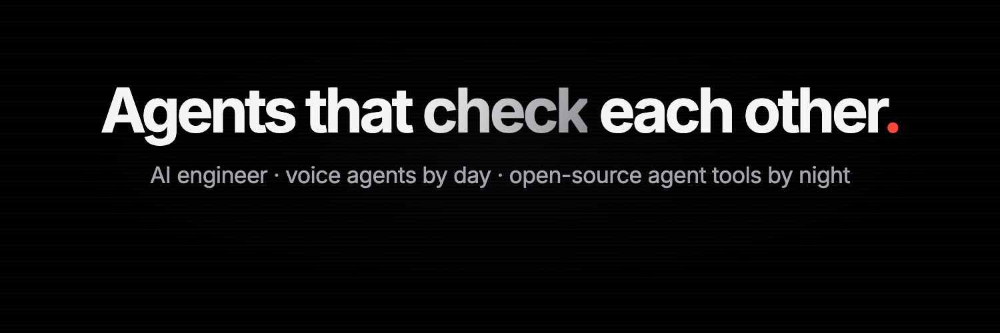

## Hi, I'm Shawn

AI engineer in the UAE. I ship voice agents to production for a living, and build open-source tools for AI coding agents on the side.

- Building voice AI agents that take real calls for real businesses
- Running Claude Code, Codex and Cursor side by side, and making them check each other's work
- Shipping in public on X: [@shawncoding](https://x.com/shawncoding)

### Building now

**sealed-council**: blind peer review for AI coding agents. Claude Code, Codex and Cursor each answer the same question, then rank each other's answers without knowing who wrote what. Names come back only after the verdict. Open source, launching 14 Nov 2026.

### Projects

| Project | What it does | Stack |
| --- | --- | --- |
| [AIphotoApp](https://github.com/shawnlasrado20/AIphotoApp) | AI photo app: pick a trending look, upload a selfie, get the AI version | React Native, TypeScript |
| [langgraph-proj](https://github.com/shawnlasrado20/langgraph-proj) | Content moderator: a LangGraph flow sorts text into spam, toxic, off-topic or clean | LangGraph, FastAPI, OpenAI |
| [rag-csv](https://github.com/shawnlasrado20/rag-csv) | Upload a CSV and ask questions about it | LangChain, FastAPI, OpenAI |
| [resume_parser_api](https://github.com/shawnlasrado20/resume_parser_api) | Turns resumes into structured data | Python, FastAPI |

### Stack

### Find me

[X](https://x.com/shawncoding) · [LinkedIn](https://www.linkedin.com/in/shawn-lasrado-a1103125a) · [Portfolio](https://shawn-portfolio.vercel.app)
